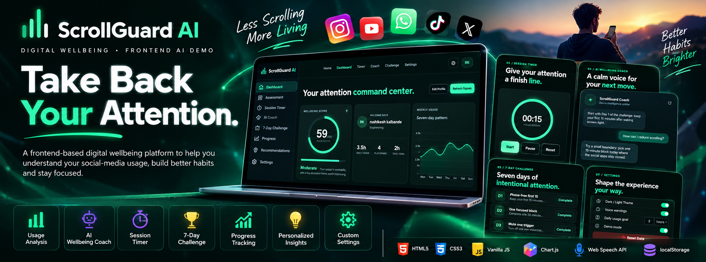
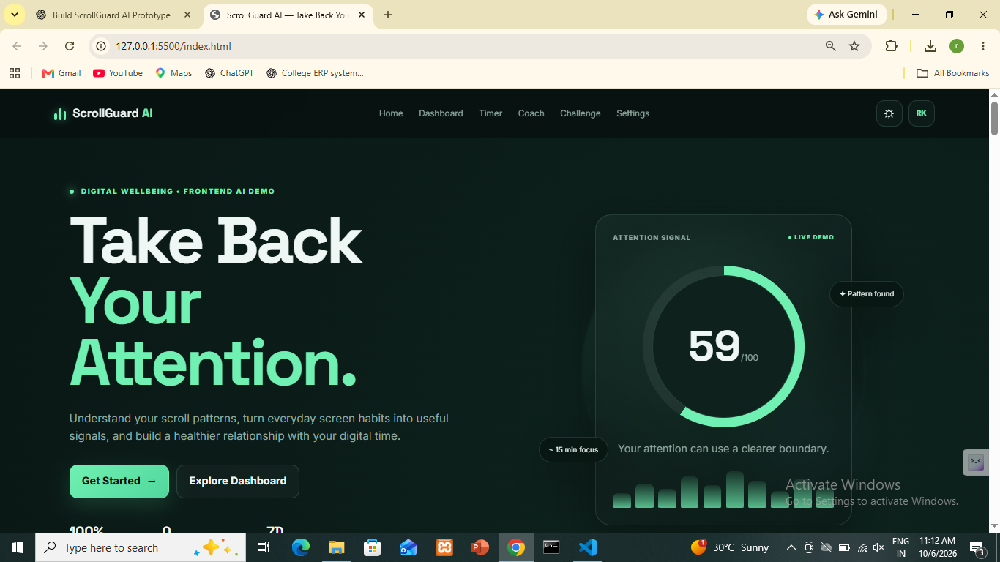
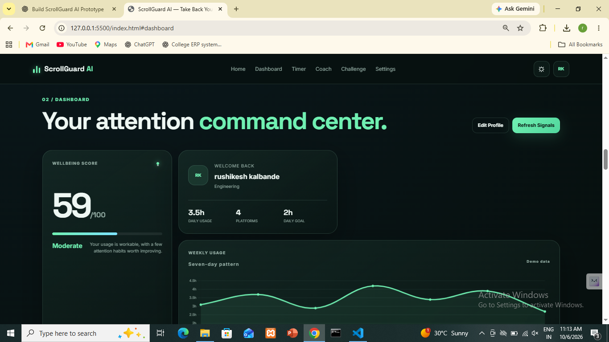
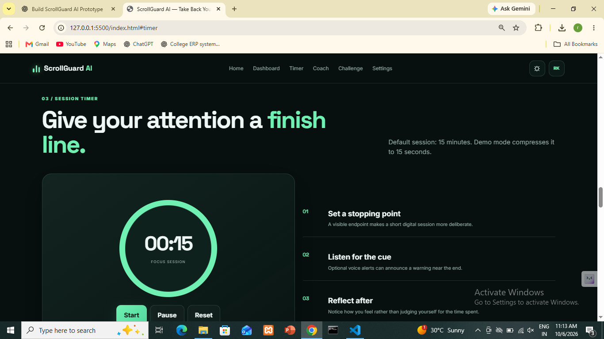
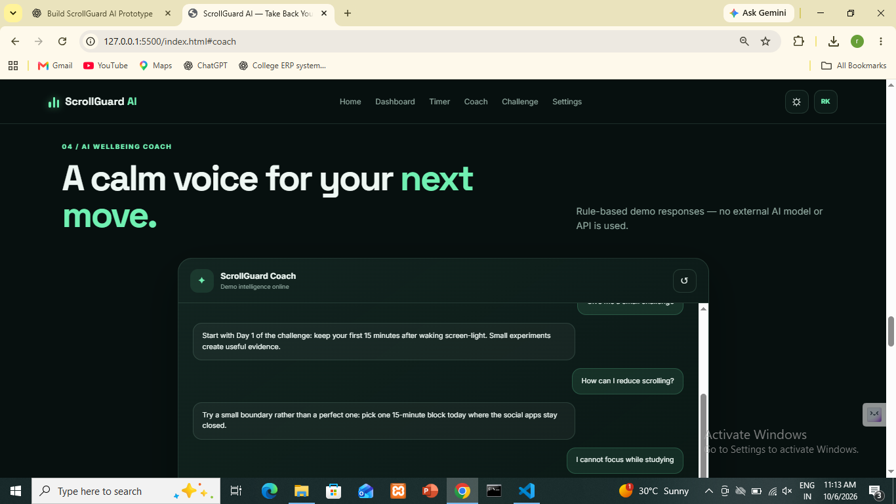
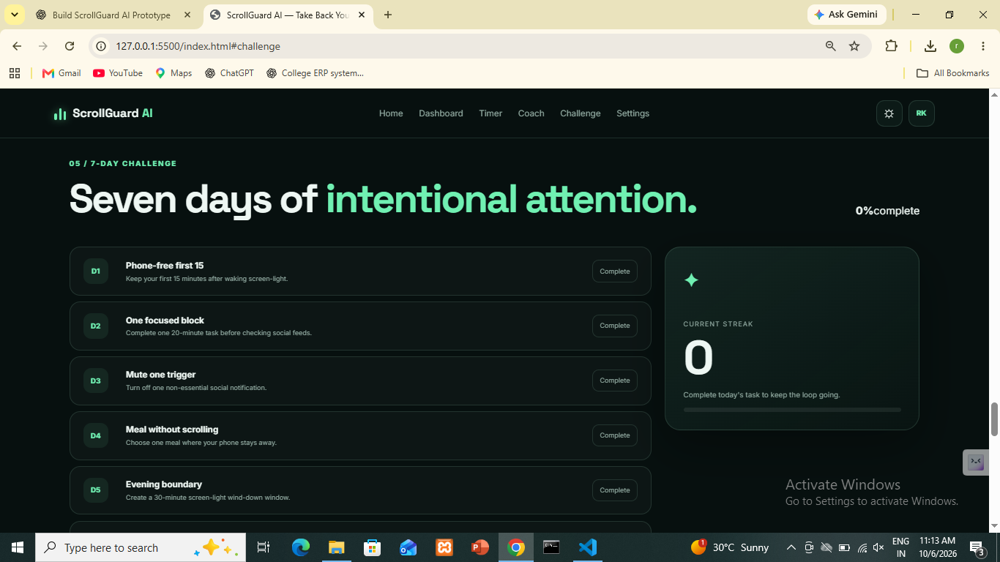
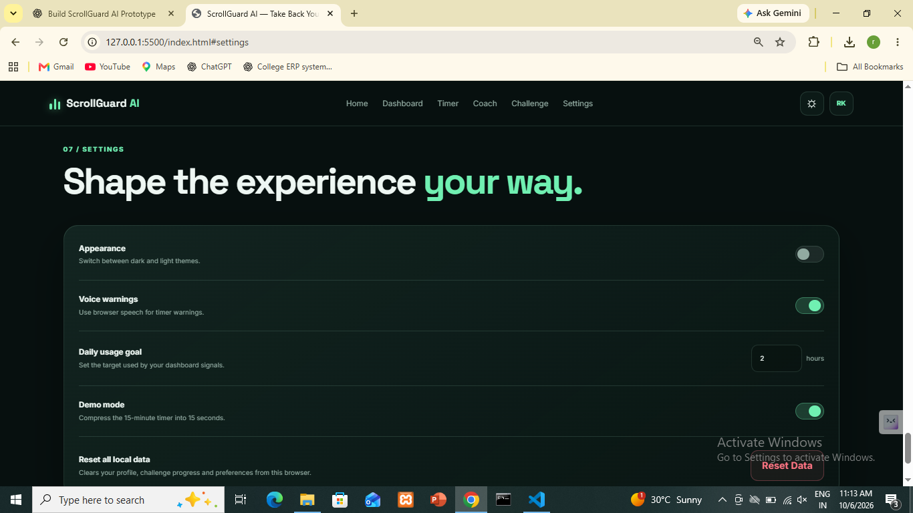

# ScrollGuard AI — Take Back Your Attention

<p align="center">
  
</p>

<p align="center">
  <strong>A frontend-only digital wellbeing experience for understanding scroll patterns, building better habits, and protecting attention.</strong>
</p>

<p align="center">
  <a href="#features">Features</a> •
  <a href="#demo">Demo</a> •
  <a href="#tech-stack">Tech Stack</a> •
  <a href="#run-locally">Run Locally</a> •
  <a href="#future-scope">Future Scope</a>
</p>

---

## 🚀 Project Overview

**ScrollGuard AI** is a modern digital-wellbeing web application created as a frontend prototype for an AI Web Development competition.

The application helps users reflect on their digital habits through:

- Usage-pattern analysis
- A rule-based wellbeing score
- Personalized insights
- A guided focus-session timer
- An AI-style wellbeing coach
- A 7-day attention challenge
- Progress and streak tracking
- Configurable digital-wellbeing settings

> **Important:** This is a frontend demonstration. The project does **not** medically diagnose addiction or any health condition. The intelligent behavior is implemented with JavaScript-based demo/rule logic. Real AI/LLM integration is future scope.

## ✨ Features

| Feature | Description |
|---|---|
| 🧠 Wellbeing Assessment | Calculates a demo digital-wellbeing score from user inputs and usage patterns. |
| 📊 Personalized Dashboard | Shows score, usage level, weekly usage visualization, insights and recommendations. |
| 📈 Weekly Analytics | Uses Chart.js to visualize a seven-day usage pattern. |
| ⏱️ Session Timer | Provides a 15-minute focus/session boundary with pause and reset controls. |
| ⚡ Demo Mode | Compresses the 15-minute timer into a 15-second demonstration for judges. |
| 🔊 Voice Warnings | Optional browser text-to-speech warnings using the Web Speech API. |
| 🤖 AI Wellbeing Coach | Chat-style interface powered by predefined JavaScript response logic. |
| 🎯 7-Day Challenge | Tracks daily wellbeing actions, completion and streaks. |
| 📈 Progress Tracking | Visualizes challenge completion and demo progress. |
| ⚙️ Settings | Theme, voice warning, usage goal, demo mode and local-data reset controls. |
| 💾 Local Persistence | Stores profile, settings and challenge progress in browser localStorage. |
| 📱 Responsive UI | Designed for desktop, tablet and mobile layouts. |

## 🖥️ Interface Preview

### Landing Page



### Dashboard



### Session Timer



### AI Wellbeing Coach



### 7-Day Challenge



### Settings



## 🧩 User Flow

```text
Landing Page
     ↓
Onboarding
     ↓
Digital Wellbeing Assessment
     ↓
Personalized Dashboard
     ↓
Session Timer
     ↓
Insights & Recommendations
     ↓
AI Wellbeing Coach
     ↓
7-Day Challenge
     ↓
Progress Tracking
     ↓
Settings
```

## 🛠️ Tech Stack

| Technology | Purpose |
|---|---|
| HTML5 | Semantic application structure |
| CSS3 | Responsive UI, glassmorphism, animations and themes |
| Vanilla JavaScript | Application logic, state, interactions and rule-based intelligence |
| Chart.js | Weekly usage visualization |
| Web Speech API | Optional browser voice warnings |
| localStorage | Client-side persistence |

### No Backend Required

This project intentionally uses **no**:

- Backend server
- Database server
- Authentication system
- Python
- PHP
- Node.js backend
- External AI API

The prototype can be opened directly in a browser.

## 📁 Project Structure

```text
scrollguard-ai/
├── .github/
│   └── workflows/
│       └── deploy-pages.yml
├── assets/
│   ├── scrollguard-banner.png
│   ├── hero-preview.png
│   ├── dashboard-preview.png
│   ├── timer-preview.png
│   ├── coach-preview.png
│   ├── challenge-preview.png
│   └── settings-preview.png
├── index.html
├── style.css
├── script.js
├── .gitignore
├── LICENSE
└── README.md
```

## ▶️ Run Locally

### Option 1 — Direct Browser

1. Download or clone the repository.
2. Open the project folder.
3. Double-click `index.html`.
4. The application will open in your browser.

### Option 2 — VS Code Live Server

Open the folder in VS Code and use the **Live Server** extension.

Example URL:

```text
http://127.0.0.1:5500/index.html
```

## 🌐 GitHub Pages Deployment

This repository includes a GitHub Actions workflow for static deployment to **GitHub Pages**.

After pushing the repository to GitHub:

1. Open **Settings → Pages** in the repository.
2. Under **Build and deployment**, select **GitHub Actions**.
3. Push changes to the `main` branch.
4. GitHub Actions will publish the site.

Your public project URL will normally follow this pattern:

```text
https://YOUR-USERNAME.github.io/scrollguard-ai/
```

## 🧪 Competition Demo Mode

For a live judging demonstration:

1. Open **Settings**.
2. Enable **Demo Mode**.
3. Go to **Session Timer**.
4. Start the timer.
5. The normal 15-minute session is compressed to **15 seconds**.
6. Demonstrate the warning and completion workflow.

This makes the project easy to demonstrate within a short judging window.

## 🔐 Privacy by Design

The current prototype keeps profile information, settings and challenge progress in the browser using `localStorage`.

There is no application database and no user account system.

Because this is a frontend prototype, users should avoid entering sensitive personal information.

## 🤖 Intelligent Behavior

The project demonstrates AI-like personalization through deterministic JavaScript rules.

Examples include:

```text
User usage + habits
        ↓
JavaScript rule engine
        ↓
Wellbeing score
        ↓
Usage level
        ↓
Personalized observations
        ↓
Recommendations / coach responses
```

This makes the project suitable for demonstrating the **concept and UX of intelligent digital wellbeing** without requiring an external AI service.

## 🔮 Future Scope

Potential next-stage improvements include:

- Real LLM-powered wellbeing coaching
- Browser extension for real usage telemetry
- Secure cloud synchronization
- User authentication
- Advanced behavioral analytics
- Personalized recommendation models
- Cross-device progress synchronization
- Privacy-preserving analytics
- PWA/mobile application support

## 🎯 Project Goal

> **Take Back Your Attention.**

ScrollGuard AI is designed around a simple idea: technology should help users become more intentional about their attention, not simply consume more of it.

## 👨‍💻 Author

**Rushikesh Kalbande**

Frontend / AI Web Development Project

## 📄 License

This project is released under the [MIT License](LICENSE).
